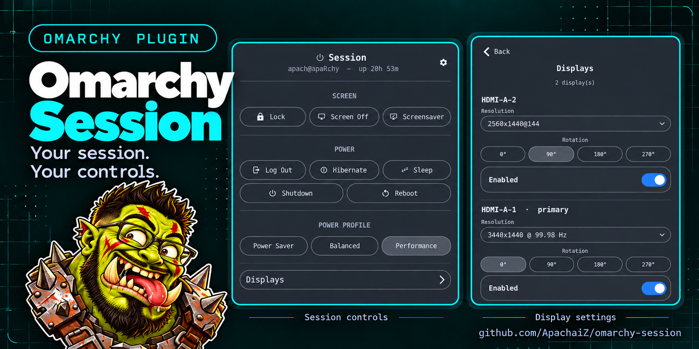
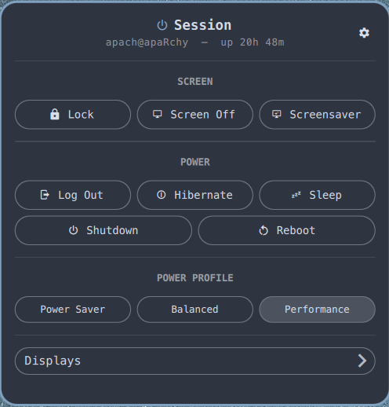
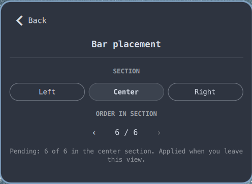

# Omarchy Session Widget



A bar widget for [Omarchy](https://omarchy.org) that gathers the actions you
reach for at the end of a session: lock or blank the screen, run the
screensaver, suspend, hibernate, log out, reboot, shut down — plus power
profile and per-monitor display controls.

It installs as `apach.session` and puts a power glyph (`󰐥`) on the bar.
Clicking it opens the Session panel.

## Features

| Section | Controls |
|---|---|
| Screen | Lock · Screen Off · Screensaver |
| Power | Log Out · Hibernate · Sleep; then full-width Shutdown · Reboot |
| Power Profile | Power Saver · Balanced · Performance (via power-profiles-daemon) |
| Displays | mode (resolution + refresh) dropdown, rotation (0°/90°/180°/270°), on/off toggle — per monitor |

The header shows the Session icon and name, with the live
`user@hostname — uptime` line underneath. The gear button opens **Bar
placement**, where the widget can be moved between the left, center, and right
bar sections and reordered inside its section.

Placement changes are batched locally while the view is open and applied when
you leave it. The panel therefore stays open while you chain section and order
changes; `omarchy bar move` runs once at the end.

## Screenshots

| Session panel | Bar placement |
|---|---|
|  |  |

## Actions

| Button | Command |
|---|---|
| Lock | `omarchy-system-lock` |
| Screen Off | `omarchy-brightness-display off` (DPMS off) |
| Screensaver | `omarchy-launch-screensaver force` |
| Shutdown | `omarchy-system-shutdown` |
| Reboot | `omarchy-system-reboot` |
| Log Out | `omarchy-system-logout` |
| Hibernate | `systemctl hibernate` (disabled when `omarchy-hibernation-available` fails) |
| Sleep | `systemctl suspend` |

Bar placement is written with `omarchy bar move`, so the running shell
hot-reloads the new layout. The widget only reads `shell.json` to display its
current section and index.

## Theme

Every color, font size, spacing value, border, and state comes from the active
Omarchy theme through `bar.foreground`, `Commons.Color.accent`, and the
`Style.*` tokens. Switching themes updates the bar icon, panel, buttons,
section labels, and secondary text live; no theme-specific color is hard-coded.

## Requirements

- Omarchy with the `omarchy-shell` Quickshell framework and the
  `qs.Ui`/`qs.Commons` component kit.
- A Nerd Font for the icons.
- `power-profiles-daemon` for the profile row (the row stays empty without it).

On a vanilla Arch install without the Omarchy shell the widget will not load.

## Install

```bash
omarchy plugin add https://github.com/ApachaiZ/omarchy-session.git --enable
```

## Uninstall

```bash
omarchy plugin remove apach.session --yes
```

This removes the widget from the bar and the plugin from
`~/.config/omarchy/plugins/`.

## Files

```
manifest.json              # plugin registration (id: apach.session)
Panel.qml                  # bar button, panel views, actions, placement settings
Model.js                   # monitors, profiles, shell.json placement, uptime formatting
preview.png                # marketplace presentation image
screenshots/panel.png
screenshots/bar-placement.png
```

## Notes

- Resolution/refresh/rotation changes are **session-only**: they survive until
  the next logout, not across reboots. Persist them in
  `~/.config/hypr/monitors.lua` if you want them permanent.
- Placement changes persist in `~/.config/omarchy/shell.json`.
- The root `preview.png` is the marketplace presentation image; the detailed
  captures live under `screenshots/`.
- Arrangement (dragging monitors to reposition them) and a "primary display"
  concept are not included — Hyprland has no persistent primary-monitor flag,
  and drag-arrangement is out of scope for a keyboard-driven panel.

## License

MIT — see [LICENSE](LICENSE).
